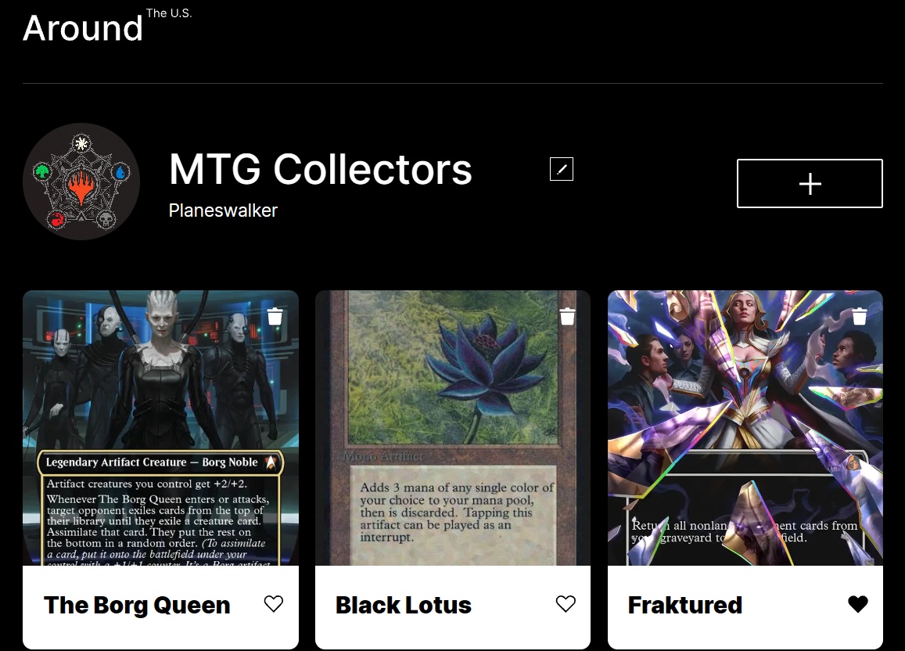

Around The U.S. — React

A full-stack-ready front end for "Around The U.S.", a photo-sharing app where users manage their profile and a gallery of places. Built with React and TypeScript, and connected to a REST API.

Screenshots

Features
Profile loaded from the API (name, description and avatar).
Card gallery with like and delete actions.
Delete button shown only on cards created by the current user.
Profile and avatar editing.
New card creation, added to the top of the gallery.
Enlarged image popup.
Technologies
React — components, props, useState, useEffect, useRef and the Context API.
TypeScript — typed props, state and API responses.
Vite — development environment.
Fetch API — requests with async/await.
HTML5 and CSS3 — responsive layout using the BEM methodology.
Project structure
src/
├── components/   Header · Main · Footer · Card · Popup · forms
├── contexts/     CurrentUserContext
├── types/        data types
└── utils/        api.ts (Api class)
Getting started
bash
npm install
npm run dev

The app opens at http://localhost:3000.